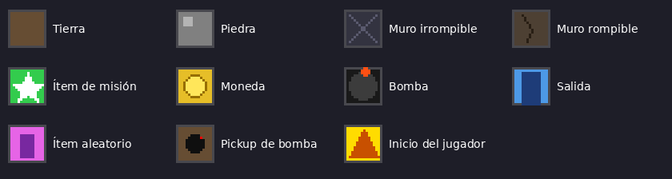

# Manual: Editor de niveles de Excavación

Cómo pintar un nivel del minijuego de Excavación en Godot y conectarlo a un trigger. Las reglas del juego (gravedad, bombas, victoria) están en `Minigames_Guide.md`. El diseño y la decisión técnica están en `Propuesta_Editor_Niveles_Excavacion.md`.

---

## 1. Piezas del editor

| Pieza | Ruta | Para qué sirve |
|---|---|---|
| Preset en blanco | `rpg-g/src/minigames/mg_excavation/levels/exc_level_template.tscn` | Punto de partida de cada nivel nuevo. Ya trae todo armado. |
| Tileset | `rpg-g/assets/sprites/excavation_tileset.tres` | Los tiles con los que se pinta. Cada uno indica qué es con el custom data `excavation_tile`. |
| Arte de los tiles | `rpg-g/assets/sprites/excavation_tiles_placeholder.png` | Placeholder de 16×16 por tile. Se puede reemplazar sin romper niveles, siempre que se mantenga el orden. |
| `ExcavationLevel` | `excavation_level.gd` | Raíz del nivel. Muestra warnings si falta algo. |
| `ExcavationItemMarker` | `excavation_item_marker.gd` | Ítem colocado a mano que da exactamente el ítem que elijas. |
| Nivel de ejemplo | `levels/test_exc_level.tscn` | Nivel de prueba con todos los elementos. |

Estructura de una escena de nivel:

```
ExcavationLevel      (raíz, script excavation_level.gd)
├── Terrain          (TileMapLayer con excavation_tileset.tres)
└── Items            (Node2D en 0,0)
    └── ...          (ExcavationItemMarker, opcionales)
```

---

## 2. Qué es cada ícono



Las celdas **sin pintar son espacio vacío**. No hace falta pintar el vacío; por eso el primer cuadro del atlas está libre.

| Ícono | Tile | Qué hace en el juego |
|---|---|---|
| Cuadro marrón liso | **Tierra** | Bloquea el paso. El jugador la cava al caminar encima, o con espacio + dirección sin moverse. Las piedras no ruedan sobre ella. |
| Cuadro gris con un punto claro | **Piedra** | Cae si tiene vacío debajo. Rueda hacia un costado si está sobre otra piedra, moneda o bomba y el costado está libre. Se empuja solo en horizontal y con hueco libre detrás. Si cae sobre el jugador, lo mata. |
| Gris oscuro con una X | **Muro irrompible** | No se cava, no se empuja y resiste las explosiones. Sirve para bordes y estructuras fijas. |
| Marrón oscuro con una grieta | **Muro rompible** | No se cava ni se empuja, pero una explosión lo destruye. Sirve para cerrar zonas que solo se abren con bomba. |
| Estrella blanca sobre verde | **Ítem de misión** | Objetivo de la condición `Mission Item`. Se recoge al pasar. Una explosión lo destruye, y si pasa, el nivel ya no se puede ganar y el jugador decide rendirse. |
| Moneda amarilla | **Moneda** | Suma al contador de las condiciones `All Coins` y `Specific Amount`, y da oro. Cae y rueda como una piedra, y también mata si cae sobre el jugador. Una explosión la destruye y no se descuenta del total. |
| Círculo negro con mecha naranja | **Bomba** (ambiental) | Cae, rueda y se empuja como una piedra. Explota en 3×3 si cae y choca, o si algo cae sobre ella. Si la alcanza otra explosión, se pone roja y explota 0.15 s después, en cadena. |
| Puerta azul | **Salida** | Se abre cuando se cumple el objetivo. Con `Exit Only` está abierta desde el inicio. Resiste las explosiones. |
| Rectángulo violeta sobre rosa | **Ítem aleatorio** | Da un ítem al azar del `item_pool` del nivel o de la acción. Para un ítem concreto, usá un `ExcavationItemMarker` (sección 4). |
| Círculo negro con punto rojo sobre tierra | **Pickup de bomba** | Suma 1 bomba manual. Con espacio sostenido 0.35 s sin moverse se planta una bomba, que explota en 3×3 a los 3 s. No cae. |
| Triángulo naranja sobre amarillo | **Inicio del jugador** | Celda donde arranca el jugador. Al jugar se convierte en vacío. Poné **uno solo**. |

---

## 3. Crear un nivel paso a paso

1. **Duplicar el preset.** En el FileSystem, click derecho sobre `levels/exc_level_template.tscn`, elegí *Duplicate* y ponele un nombre en `snake_case`, por ejemplo `exc_level_mina_01.tscn`.
2. **Abrirlo y seleccionar `Terrain`.** Abajo se abre el panel *TileMap* con los tiles del tileset.
3. **Pintar.** Usá lápiz, rectángulo o balde. Clic derecho borra, y lo borrado queda como vacío. Una celda equivale a un tile de 16×16.
4. **Poner el inicio y la salida.** Un tile de inicio y al menos una salida.
5. **Revisar los warnings.** Si aparece un ícono amarillo en la raíz `ExcavationLevel`, pasá el mouse encima para ver qué falta (sección 5).
6. **Guardar.** Ctrl+S.

Opciones de la raíz `ExcavationLevel`:

| Propiedad | Qué hace |
|---|---|
| `auto_border` (activado por defecto) | Rodea el área pintada con muro irrompible para que el jugador no salga de la grilla. No hace falta pintar el borde. |
| `item_pool` | Lista de ítems para los tiles de ítem aleatorio. Si la dejás vacía, se usa la del `MinigameAction`. |

> El tamaño del nivel es el rectángulo que cubre todo lo pintado. Una celda suelta lejos agranda el nivel y deja vacío alrededor, así que conviene borrarla.

---

## 4. Ítems a mano

1. Con `Items` seleccionado, agregá un `Node2D` hijo y asignale el script `excavation_item_marker.gd`. También podés duplicar un marker que ya exista.
2. En el inspector:
   - `item_id`: el id de `ItemDatabase`, por ejemplo `red_potion`, `blue_gem` o `ancient_map`.
   - `amount`: la cantidad que da.
3. Arrastralo sobre la celda que quieras; se encaja solo al centro de la celda. En el editor se ve como un cuadro violeta con el id encima.
4. En el juego, esa celda se convierte en un ítem que da exactamente ese ítem. Si estaba pintada, el marker reemplaza lo pintado.

`Items` tiene que quedar en (0, 0); si lo movés, los markers se desalinean de la grilla.

---

## 5. Warnings del nodo raíz

| Warning | Qué significa |
|---|---|
| *No player start tile* | Falta el inicio. El jugador arranca en la esquina superior izquierda del área. |
| *N player start tiles* | Hay más de un inicio. Se usa uno solo. |
| *No exit tile* | No hay salida. Solo se puede ganar con `require_exit = false`. |
| *The exit is sealed off by unbreakable walls* | Ni con bombas se llega a la salida. |
| *Item marker '…' is outside the painted area* | El marker quedó fuera del nivel y se ignora. |
| *Item marker '…' has no item_id* | Falta el `item_id`. |
| *Terrain uses the deprecated TileMap node* | El nivel usa el nodo `TileMap` viejo. Funciona, pero para niveles nuevos usá el preset, que trae `TileMapLayer`. |

---

## 6. Conectarlo a un trigger y definir cómo se gana

El nivel solo define el **mapa**. La condición de victoria va en el `MinigameAction`, así un mismo nivel sirve para varias misiones.

1. En el nivel del overworld, seleccioná el minijuego: el `minigame_interactable` de LevelApp o tu `GameTrigger`.
2. En `actions_if_true`, abrí el `MinigameAction` y poné `minigame_type = Excavation`.
3. `excavation_level_scene`: elegí tu `.tscn`. Si lo dejás vacío, el nivel es procedural.
4. `excavation_win_condition`:

| Opción | Se gana cuando… |
|---|---|
| `All Coins` | se juntan todas las monedas del nivel. |
| `Specific Amount` | se juntan `excavation_target_amount` monedas. Si el número supera las monedas del nivel, se limita al total. |
| `Mission Item` | se recoge el ítem de misión. |
| `Exit Only` | se llega a la salida, que está abierta desde el inicio. |

5. `excavation_require_exit`:
   - `true` (por defecto): después del objetivo hay que caminar hasta la salida.
   - `false`: se gana apenas se cumple el objetivo.
6. Configurá también `excavation_initial_bombs`, `excavation_item_pool`, `excavation_scale` y las rutas de vuelta (`win_level_path`, `win_spawn_id`, `lose_level_path`, `lose_spawn_id`).

Ejemplos con un mismo nivel:
- **Juntar monedas:** `All Coins` y `require_exit = false`.
- **Llegar al final:** `Exit Only`.
- **Ambas cosas:** `All Coins` y `require_exit = true`.

---

## 7. Cambiar el arte

`excavation_tiles_placeholder.png` es una tira de 12 cuadros de 16×16. El primero queda libre y el resto va en el orden de la leyenda. Para poner el arte final, reemplazá el PNG **manteniendo cada ícono en la misma posición**. El juego reconoce el tile por su custom data, no por el dibujo, así que los niveles ya pintados siguen funcionando.

Hoy el juego todavía dibuja el nivel con formas simples en `_draw()`. El arte del tileset se ve en el editor. Usarlo también dentro del juego sería una fase siguiente.

La explosión usa `excavation_explosion_placeholder.png`, una tira de 4 cuadros de 16×16 que se reproduce en las 9 celdas del 3×3. Los ajustes son `EXPLOSION_FRAMES` y `EXPLOSION_FRAME_TIME` en `mg_excavation_game.gd`.
